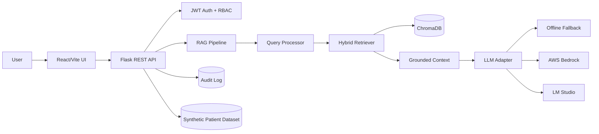

# MediQueryNow — RAG-Based Clinical Information Retrieval Platform

MediQueryNow is a final-year full-stack healthcare information-retrieval project that combines semantic search, structured filtering, role-based access control, audit logging, and optional large-language-model generation.

> **Safety:** This is an academic/research information-retrieval system. It is not a medical device, diagnostic engine, or replacement for a qualified healthcare professional. The included dataset is synthetic/demo data.

## 1. Highlights

- React + Vite responsive clinical dashboard
- Flask REST API
- JWT authentication and server-side authorization
- Provider / Patient / Insurer / Admin roles
- Patient-record privacy redaction for insurer access
- ChromaDB persistent vector search
- SentenceTransformers semantic embeddings
- Natural-language query filter extraction
- RAG context grounding and source references
- Offline deterministic fallback when no LLM is configured
- Optional AWS Bedrock or LM Studio generation
- Audit trail for sensitive operations
- Search history and system-health dashboard
- Docker + Docker Compose deployment
- Automated vector-index initialization
- Unit tests for authentication, authorization logic and query parsing

## 2. Architecture



## 3. Quick start — Docker

1. Install Docker Desktop / Docker Engine.
2. Copy the environment template:

```bash
cp .env.example .env
```

3. Change `JWT_SECRET` and the demo passwords for any non-local deployment.
4. Start:

```bash
docker compose up --build
```

5. Open:

```text
http://localhost:8080
```

The first backend startup downloads the embedding model and builds the ChromaDB index. Subsequent starts reuse the persistent index.

### Demo accounts

| Username | Password | Role |
|---|---|---|
| provider | Provider@123 | Provider |
| patient9 | Patient@123 | Patient (P009) |
| insurer | Insurer@123 | Insurer |
| admin | Admin@123 | Administrator |

Change these values in `.env` before deployment.

## 4. Local development

### Backend

```bash
python -m venv .venv
# Linux/macOS
source .venv/bin/activate
# Windows
# .venv\Scripts\activate

pip install -r requirements.txt
cp .env.example .env
python -m vector_embedding.embed_patients
python -m backend.app
```

Backend:

```text
http://localhost:5000
```

### Frontend

```bash
cd frontend
npm ci
npm run dev
```

Frontend:

```text
http://localhost:5173
```

Set:

```text
VITE_API_BASE_URL=http://localhost:5000
```

for local development if Vite does not use the default.

## 5. LLM modes

The application works without an external LLM.

### Offline — default

```env
LLM_PROVIDER=offline
```

The RAG pipeline retrieves records and uses the built-in deterministic response engine. This is the easiest mode for a viva/demo.

### AWS Bedrock

```env
LLM_PROVIDER=bedrock
AWS_REGION=us-east-1
BEDROCK_MODEL_ID=us.meta.llama3-3-70b-instruct-v1:0
```

Provide AWS credentials through the normal AWS credential chain or IAM role.

### LM Studio

```env
LLM_PROVIDER=lmstudio
LM_STUDIO_BASE_URL=http://host.docker.internal:1234/v1
LM_STUDIO_MODEL_NAME=your-loaded-model
```

Start LM Studio's OpenAI-compatible local server before querying.

## 6. API

### Login

`POST /api/auth/login`

```json
{"username":"provider","password":"Provider@123"}
```

Returns a signed JWT.

### Current user

`GET /api/auth/me`

Requires:

```text
Authorization: Bearer <token>
```

### Query

`POST /api/query`

```json
{"query":"Patients with HbA1c above 7%"}
```

### Patient list

`GET /api/patients?search=Patient&condition=diabetes`

### Patient details

`GET /api/patients/P009`

### Health

`GET /api/health`

Health is intentionally public for container orchestration.

### Rebuild index

`POST /api/rebuild-embeddings`

Provider and Admin roles only.

### Audit log

`GET /api/audit-logs`

Admin only.

## 7. Project modules

```text
backend/              Flask API + authentication
frontend/             React/Vite application
rag_engine/           RAG orchestration + LLM adapters
retrieval/            query processing + semantic retrieval
vector_embedding/     normalization + embedding/index construction
data/                 synthetic demo records
tests/                automated unit tests
docs/                 project documentation
```

## 8. Testing

Install dependencies, then:

```bash
pytest -q
```

For the full embedding/RAG path, initialize the vector index first:

```bash
python -m vector_embedding.embed_patients
```

## 9. Deployment notes

For a university demo, Docker Compose is the recommended path.

For production-like deployment:

- use a strong random `JWT_SECRET`
- use unique passwords
- restrict `CORS_ORIGINS`
- terminate TLS at a reverse proxy/load balancer
- use managed persistent storage for ChromaDB or migrate to a managed vector database
- move audit logs to a database/object store with retention controls
- replace demo authentication with an institutional identity provider
- use synthetic/de-identified data unless all required healthcare privacy/security controls have been implemented
- perform security, privacy, clinical-safety and penetration testing before any real clinical use

## 10. Academic scope

This project demonstrates:

1. Full-stack application engineering
2. REST API design
3. Authentication and RBAC
4. Vector databases
5. Semantic information retrieval
6. Retrieval-Augmented Generation
7. Natural-language query understanding
8. Data normalization and provenance
9. Privacy-aware redaction
10. Auditability
11. Containerization and deployment
12. Automated testing

## 11. Limitations

- The included patient dataset is synthetic.
- The offline response generator is intentionally deterministic and not a clinical reasoning model.
- Semantic retrieval quality depends on the embedding model.
- External LLM quality and availability depend on the configured provider.
- This release is suitable for academic demonstration, not direct clinical deployment.

## 12. License

Add the license required by your university or project team before public redistribution.
## 🎓 Higher-Officials Demonstration

For a ready-to-run demonstration, use `DEMO_GUIDE.md`. The easiest launch is:

**Windows:** double-click `run_demo.bat`

**macOS/Linux:** `./run_demo.sh`

Then open **http://localhost:8080**. The application includes synthetic patient records and four demo roles, so no real patient data or external AI credentials are required for the standard presentation.

The recommended demonstration path is **Provider login → Dashboard → Patient Directory → Medical Inquiry → Patient privacy test → Admin Audit Logs → System Health**.

